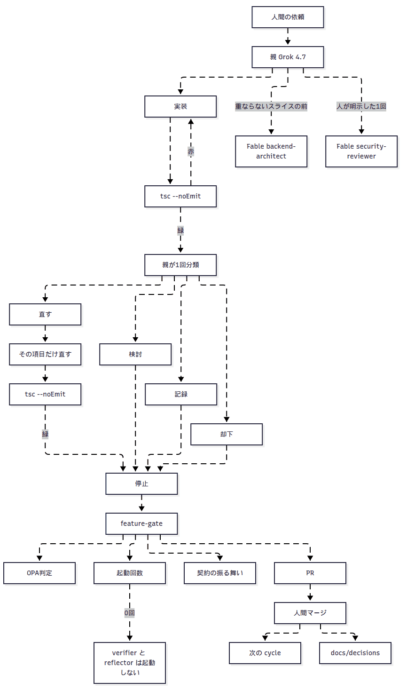
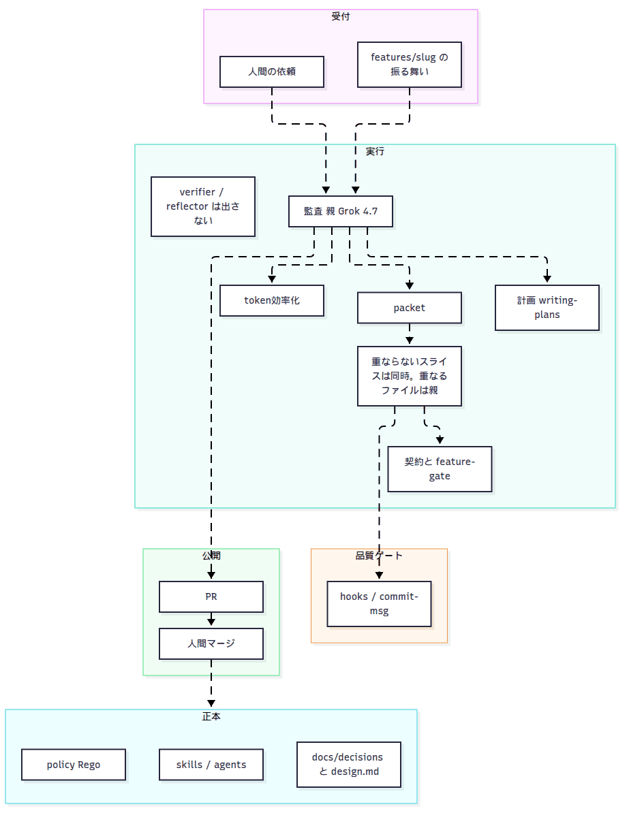
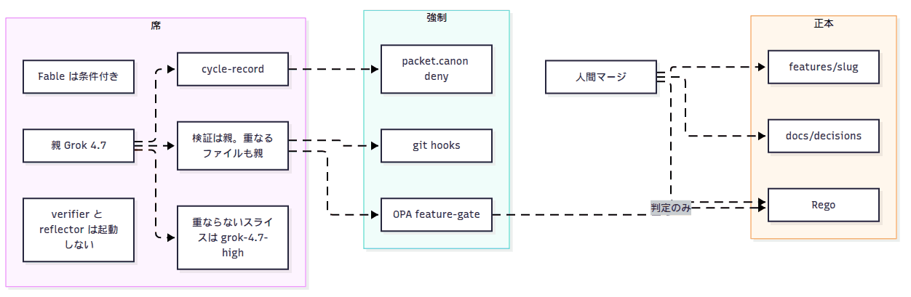
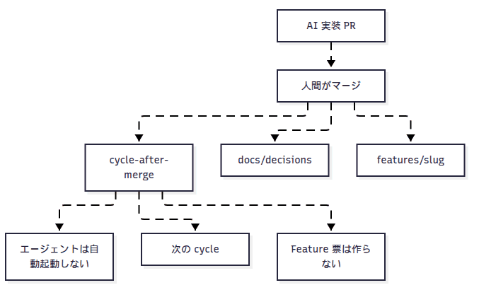

# marumo-cloud

Cursor、Claude Code、Codex で同じ契約を使う**テンプレート**。対象は席・正本・ゲート・cycle（[ADR 0039](docs/decisions/0039-harness-template-cycle-graph.md)）。
ライセンスは [MIT](LICENSE)（Copyright (c) 2026 marumo333）。

## 実行環境

開発は Cursor、Claude Code、Codex。ゲート（`feature-gate` / OPA）は Linux amd64 の CI と、各ホストの commit 前 hook で通す。macOS / Windows / Linux arm64 ではゲートは動かない。
`.agents/skills` は `.claude/skills` へのシンボリックリンクである。Windows では開発者モードが無いと辿れない。
手元の clone は閲覧と空リポへの載せに使う。commit とゲートはクラウドまたは Actions で通す。

## ガードの限界

秘密の読み取りガードが止めるのは、ファイルを直接開く読みと、`cat` / `head` / `tail` / `less` / `more` / `source` / `printenv` だけである。`grep`、`awk`、`python` の open、`cp` は止まらない。拒否リストを足しても、シェルの書き方は残る。Claude Code は `.claude/settings.json` の `permissions.deny` が `Read(./.env)` を止める。確実に守ることは、秘密をリポジトリへ置かないことである。

commit ガードは `--no-verify` と `-n` に加え、`sh -c` と `eval` の中、フラグ位置のコマンド置換を拒否する。壊れた hook 入力は許可に倒さず拒否する。完全なシェル解析ではない。

秘密の書き込みは、パスが `src` であるかに依存しない。Codex の編集が `apply_patch` のとき、`.codex/hooks.json` の matcher にその名前を含める。ホストが別名を出す場合は、このガードには届かない。

## 何をするか

- 席: 親はホストの既定。モデル ID は指定しない。検証は親が契約と feature-gate を実行する。検証用の subagent は出さない
- 機能の正本は `features/<slug>/` の振る舞いとテスト。機能ごとに ADR、レビュー、proposed、admitted は作らない
- ゲート: OPA `node scripts/feature-gate.mjs`（自己改善ループそのものではない）
- 管理: skill の使用/省略を `cycle/` に書き、ノード / 辺 / 状態の3指標で計る
- 再起: 人間がマージすると次の cycle が開く。Feature 票は開かない。エージェントは自動起動しない
- パッケージ: pnpm（[ADR 0041](docs/decisions/0041-pnpm-package-manager.md)）
- commit: hook 必須。主語は `feat:` / `fix:` / `docs:` 等 + 日本語（[ADR 0042](docs/decisions/0042-always-on-precommit-ja-conventional.md)）

手順の本体は [TEMPLATE.md](TEMPLATE.md)。

## 3つのプロバイダ

対応するのは Cursor、Claude Code、Codex の3つ。どれで開いても同じ [`AGENTS.md`](AGENTS.md) と [`.claude/AGENTS.md`](.claude/AGENTS.md) を読む。

- Cursor は `.cursor/hooks.json` と `AGENTS.md`
- Claude Code は `AGENTS.md` と `.claude/AGENTS.md` と `.claude/settings.json`
- Codex は `AGENTS.md` と `.codex/hooks.json`

`CLAUDE.md` は置かない。スキルは `.claude/skills` にあり、Codex は `.agents/skills` から同じディレクトリを読む。`pnpm install` は git hooks を入れる。クラウドも手元もプロバイダとモデルは聞かない。実行はホストの既定。

## 最初にやること

どのホストでも clone 後は `pnpm install`（git hooks も入る）。プロバイダとモデルは聞かない。実行はホストの既定。プロダクトの始め方は [TEMPLATE.md](TEMPLATE.md) の「プロダクトを始める」。機能ごとに ADR は起票しない。

空リポへ載せる手順は [TEMPLATE.md](TEMPLATE.md)。
完了はクラウドまたは Actions 上で `node scripts/feature-gate.mjs` が緑であること。ハーネスにテストがある変更は `pnpm test` が緑であること（[ADR 0016](docs/decisions/0016-definition-of-done.md)）。

## アーキテクチャ

このハーネスは席・ゲート・cycle で回る。入力は人間の依頼と `features/<slug>/` の振る舞い、
実行は席、token効率化は code-mode と packet、品質ゲートは hooks / OPA / feature-gate、
成果は振る舞いのテストと `docs/decisions/` と policy、フィードバックは次の cycle である。
監査の主体は親である。モデル ID は指定しない。Uber の Gateway や艦隊は置かない。feature-gate は OPA の検査と契約とレビュー上限を実行する。canon の一覧はハーネスの正本で、差分がそこを含むと stay を拒否する。被覆率にはしない。`features/` と `src/` と `app/` の差分は、振る舞いと `tsc --noEmit` を見る。正本へは書かない。

図は [`docs/architecture/`](docs/architecture/) のアーキテクチャ概要。実線は実行、破線は条件付きか判定のみ。編集する正は同ディレクトリの mermaid（[`review-overview.mmd`](docs/architecture/review-overview.mmd) ほか）。README には画像だけを出す。

### 入口

以前は、契約が特定のモデル名を書き、動く入口は Cursor だけだった。いまは、クラウドの起動が git clone のあと初期化する。

初期化のコマンドは `node scripts/init.mjs --product` である。これは消すファイルの一覧を出すだけで、ファイルは残す。プロダクトの remote で実際に戻すのは `node scripts/init.mjs --product --apply` だけである。そのとき `cycle/events.jsonl` は空の `C-0001` になり、正本の yaml は残る。`docs/` は日付付きの日記と、決定以外の調査や図を落とす。`docs/decisions/` は残す。このテンプレートの remote では消さない。フォークしただけでは消えない。

依存の `pnpm install` は git hooks を書く。クラウドも手元もプロバイダとモデルは聞かない。三つの入口は同じ `AGENTS.md` を読む。実行はホストの既定。答えは共有の yaml には書かない。

モデルとレビューのあと、人間がマージすると次の cycle が開く。記録は `cycle/events.jsonl` への PR であり、main へは直接 push しない。


### モデルとレビュー

常時の席は親である。実行モデルはホストの既定。計画確認のあと、ファイルが重ならないスライスはホストの既定で同時に進めるのが既定。重なるファイルは親が書く。枝に分けて後からマージする十数体は入れない。完成は 1 本の PR。型の正解は `tsc --noEmit`。品質の指摘は親が1回、4つに分ける。コードを変えるのは直すだけ。緑のあと二周目は開かない。backend-architect は重ならないスライスの前だけ、security-reviewer は人が明示した1回だけ。verifier と reflector は起動せず、feature-gate が 0 回で拒否する。

モデル ID は指定しない。役割と effort は `cycle/model-routing.yaml` に残す。ゲートが見るのは席トークンと件数と effort の幅で、ホストの製品スラッグは見ない。どの agent の定義にも `model:` は置かない。根拠は [モデルの層と並列実行](docs/multi-agent-and-pins.md)。

実行の一覧は Cursor のクラウド実行面で見る。このリポジトリは席の許可とゲートである。数十体を `packet.rego` の席にはしない。根拠は [モデルの層と並列実行](docs/multi-agent-and-pins.md)。



### 監査

受付 → 計画確認 → 重ならないスライスは同時、重なるファイルは親 → 契約と feature-gate → 公開。完成は 1 本の PR。
必須の辺は無い。検証用の subagent は出さない。
feature-gate は判定であり、正本へは書かない。正本へ入るのは人間マージだけ。



### ランタイム

席と強制の層。子へ渡すのは packet だけ。会話履歴と `docs/learnings.md` の全文は継がない。
hooks を踏むのは実装の commit。feature-gate は判定であり正本へは書かない。
`packet.canon` の deny は `cycle-record` が dispatch を書くときに評価する。



### 再起的自己改善

人間のマージが点火する。cycle-after-merge は承認を記録し、次の cycle を開く。記録の commit は PR にする。main へは直接 push しない。Feature 票は作らない。エージェントは自動起動しない。正本に残るのは `docs/decisions` と `features/<slug>/` だけ。



## 構成

```
AGENTS.md         Cursor、Claude Code、Codex が読む契約
.claude/          Claude Code のエージェント / skill / hook
.cursor/          Cursor の hook
.codex/           Codex の hook
.agents/skills    Codex から .claude/skills を見る
docs/decisions/   人の判断
docs/GLOSSARY.md  用語。ここに無い名前は作らない
docs/learnings.md 実行のメモ
cycle/            cycle の記録と席のピン
policy/           OPA（ゲートと cycle）
scripts/          feature-gate / cycle-* / githooks / commit-msg
```

プロダクトの始め方は [TEMPLATE.md](TEMPLATE.md) の「プロダクトを始める」。人の判断は [`docs/decisions/`](docs/decisions/)。
