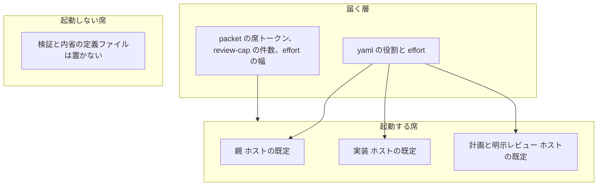

# モデルの層と、並列実行の境界

調査日: 2026-10-12。2026-10-14 に、生きた契約から製品スラッグを外した。この文書は判断のメモである。新しい ADR は作らない。役割と effort は `cycle/model-routing.yaml` に残す。どの agent の frontmatter にも `model:` は置かない。

## 製品スラッグはホストのカタログであり、このリポジトリの契約ではない

実行モデルはホストの既定である。Cursor の製品スラッグは、他のクラウドのモデル ID へ移らない。モデル ID は指定しない。

届くもの:

- 役割と effort。書く場所は yaml。ゲートはホストのモデル ID を受け取らない。
- dispatch を書いたときの席（`parent` / `implement` / `plan` / `review`）、新しい周の件数（`scripts/lib/review-cap.mjs`）、effort の幅（`scripts/lib/packet-policy.mjs`）。製品スラッグはここには書かない。
- 席の名前は役割だけである。モデルの族名は入場語彙にしない。

置かないもの:

- どの agent の `model:` も置かない。検証と内省の定義ファイルは置かない。手順は skill にあり、起動しない。
- 席の無いスラッグ。`sonnet_pin` は参照する skill が無かったので yaml から外した。`fable_pin` と `grok_task` も、ホストを Cursor に固定するので外した。
- ゲートの deny の中の製品スラッグ。ランナーが渡した文字列を、このリポジトリは解決しない。

`dispatch_seats` は `parent` / `implement` / `plan` / `review` だけを書く。yaml は実行時にパースされない。実行される写しは `scripts/lib/packet-policy.mjs` の `SEATS` と `packet.rego` の `seats` と `scripts/cycle-record.mjs` である。この3つは同じ役割名にする。

## クラウドも手元も質問しない

commit hook はホストを聞かない。Cursor の hook も聞かない。git hook は commit で走り、`hooksPath` は `pnpm install` の `prepare` が書く。その install はクラウドでも手元でも CI でも走る。クラウドの起動は git clone のあと `node scripts/init.mjs --product` を呼ぶ。これは計画だけを出す。プロダクトの remote で `cycle/` と `docs/` を空の周に戻すのは `--product --apply` のときだけである。`cycle` の正本 yaml と `docs/decisions/` は残す。`docs/GLOSSARY.md` は無いときだけ空の見出しを作り、あるときは残す。このテンプレートの remote では消さない。プロバイダとモデルは聞かない。実行モデルはホストの既定。共有の yaml には書かない。

各ホストは自分の入口を読む。Cursor は `.cursor/hooks.json` とルートの `AGENTS.md`、Claude Code はルートの `AGENTS.md` と `.claude/AGENTS.md` と `.claude/settings.json`、Codex はルートの `AGENTS.md` と `.codex/hooks.json`。`CLAUDE.md` は置かない。置くと既定の Claude は `AGENTS.md` を読まなくなる。スキルは `.claude/skills` にあり、Codex は `.agents/skills` から同じディレクトリを読む。共有のゲートは `host-default` のままである。ホスト名を yaml に書いてモデル ID を割り当てない。図は [`docs/architecture/host-entry-as-is-to-be.mmd`](architecture/host-entry-as-is-to-be.mmd)。

## 重ならないスライスは同時に進め、重なるファイルは親が書く

常時の席が親一人であることと、ファイルが重ならないスライスを同時に進めることは、同じ席表ではない。

| 面 | 何をするか | どこに置くか |
| --- | --- | --- |
| 実行 | 計画確認のあと、ファイルが重ならないスライスをホストの既定で同時に進める。モデル ID は指定しない。重なるファイルは親が書く。枝に分けて後からマージする十数体は入れない。完成は 1 本の PR。状態は実行の一覧で見る | ホストの実行一覧。このリポジトリは一覧の HTML を描かない |
| 制御 | 誰が判断してよいか、何を git に残すか、何を機械が落とすか、1周をどう数えるか | このリポジトリの席、正本、ゲート、cycle |

数十体を `packet.rego` の席に足すと、実行の並列と、判断の増殖が同じ規則になる。このリポジトリが止めたのは後者である。`C-0012` は adversarial の dispatch が 15 件だった。いまの review-cap は、人が明示したレビューを新しい周で 1 回、verify と reflect を 0 回にする。

論文は、役割を分けることと、席を増やすことが同じ結果にならない、と分かれている。

- MetaGPT は、役割と SOP と中間成果物で、会話をそのまま繋ぐより一貫した実装が出ると報告している（Hong et al., ICLR 2024。[arXiv:2308.00352](https://arxiv.org/abs/2308.00352)）。機能分解そのものは有効である。
- Agentless は、局所化、修正、検証の三段階を LLM に次の行動を選ばせずに行い、投稿時点の SWE-bench Lite で公開エージェントより高い修復率と低い費用を報告している（Xia et al., 2024。[arXiv:2407.01489](https://arxiv.org/abs/2407.01489)）。固定した手順は、自律的な多体に必ず負けるわけではない。
- MAST は、7 つの多体フレームワークの軌跡から失敗を 14 様式に分け、設計の不備、エージェント間のずれ、検証の不足にまとめている。単体に対する利得はしばしば小さく、対話手順の小変更では足りないと報告している（Cemri et al., NeurIPS 2025。[arXiv:2503.13657](https://arxiv.org/abs/2503.13657)）。

したがって、計画確認のあと、ファイルが重ならないスライスはホストの既定で同時に進める。重なるファイルは親が書く。完成は 1 本の PR のままである。枝に分けて後からマージする十数体は、この既定に入れない。常時席を数十体にすることでもない。review-cap は変えない。一覧はホストの実行一覧が持つ。このリポジトリが持つのは、その実行を何席まで許可し、完了を契約と feature-gate で落とすかである。

`docs/software-factory-survey.md` の結論とも重なる。ガバナンスのレーンに製品の UI と依存を混ぜない。
