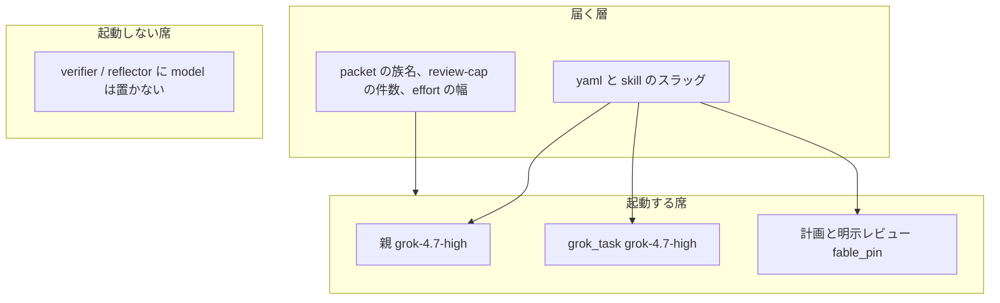

# モデルの層と、並列実行の境界

調査日: 2026-10-12。この文書は判断のメモである。新しい ADR は作らない。席の現行ピンは `cycle/model-routing.yaml` と skill と、起動する agent の `model:` だけである。

## モデルは現状の置き方で固定しない

生きている席の名前を消すことと、今のファイルの散らし方を続けることは別である。

届くもの:

- 親と `grok_task` のスラッグ、計画と人が明示したレビューの `fable_pin`。書く場所は yaml と skill。ゲートは Task の起動文字列を受け取らない。
- dispatch を書いたときの族名（`policy/packet.rego` の `seats`）、新しい周の件数（`scripts/lib/review-cap.mjs`）、effort の幅（`scripts/lib/packet-policy.mjs`）。世代の文字列はここには書かない。
- 起動する agent の `model:`。`backend-architect` と `security-reviewer` は `claude-fable-5-1-thinking-high` のまま。

置かないもの:

- 起動しない `verifier` と `reflector` の `model:`。本文が起動禁止でも、frontmatter のスラッグは起動されたときの既定になる。
- 席の無いスラッグ。`sonnet_pin` は参照する skill が無かったので yaml から外した。
- ゲートの deny の中の `grok-4.7-high`。ランナーが渡した文字列を、このリポジトリは解決しない。

`dispatch_seats` の `verify: opus` や `muse` は、世代のピンではない。記録してよい族がまだ残っている、という別の問題である。yaml は実行時にパースされない。実行される写しは `scripts/lib/packet-policy.mjs` の `SEATS_BY_NODE` と `packet.rego` の `seats` と `scripts/cycle-record.mjs` の `SEATS` である。この変更では席の集合は削らない。

## 重ならないスライスは同時に進め、重なるファイルは親が書く

常時の席が親一人であることと、ファイルが重ならないスライスを同時に進めることは、同じ席表ではない。

| 面 | 何をするか | どこに置くか |
| --- | --- | --- |
| 実行 | 計画確認のあと、ファイルが重ならないスライスを `grok-4.7-high` で同時に進める。重なるファイルは親が書く。枝に分けて後からマージする十数体は入れない。完成は 1 本の PR。状態は実行の一覧で見る | Cursor のクラウド。このリポジトリは一覧の HTML を描かない |
| 制御 | 誰が判断してよいか、何を git に残すか、何を機械が落とすか、1周をどう数えるか | このリポジトリの席、正本、ゲート、cycle |

数十体を `packet.rego` の席に足すと、実行の並列と、判断の増殖が同じ規則になる。このリポジトリが止めたのは後者である。`C-0012` は adversarial の dispatch が 15 件だった。いまの review-cap は、人が明示したレビューを新しい周で 1 回、verify と reflect を 0 回にする。

論文は、役割を分けることと、席を増やすことが同じ結果にならない、と分かれている。

- MetaGPT は、役割と SOP と中間成果物で、会話をそのまま繋ぐより一貫した実装が出ると報告している（Hong et al., ICLR 2024。[arXiv:2308.00352](https://arxiv.org/abs/2308.00352)）。機能分解そのものは有効である。
- Agentless は、局所化、修正、検証の三段階を LLM に次の行動を選ばせずに行い、投稿時点の SWE-bench Lite で公開エージェントより高い修復率と低い費用を報告している（Xia et al., 2024。[arXiv:2407.01489](https://arxiv.org/abs/2407.01489)）。固定した手順は、自律的な多体に必ず負けるわけではない。
- MAST は、7 つの多体フレームワークの軌跡から失敗を 14 様式に分け、設計の不備、エージェント間のずれ、検証の不足にまとめている。単体に対する利得はしばしば小さく、対話手順の小変更では足りないと報告している（Cemri et al., NeurIPS 2025。[arXiv:2503.13657](https://arxiv.org/abs/2503.13657)）。

したがって、計画確認のあと、ファイルが重ならないスライスは `grok-4.7-high` で同時に進める。重なるファイルは親が書く。完成は 1 本の PR のままである。枝に分けて後からマージする十数体は、この既定に入れない。常時席を数十体にすることでもない。review-cap は変えない。一覧はクラウドの実行一覧が持つ。このリポジトリが持つのは、その実行を何席まで許可し、完了を契約と feature-gate で落とすかである。

`docs/software-factory-survey.md` の結論とも重なる。ガバナンスのレーンに製品の UI と依存を混ぜない。
